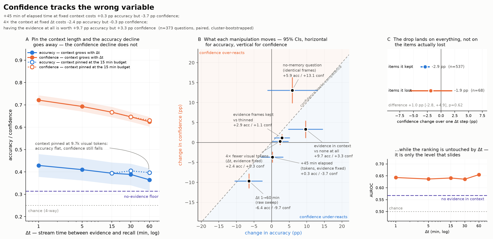
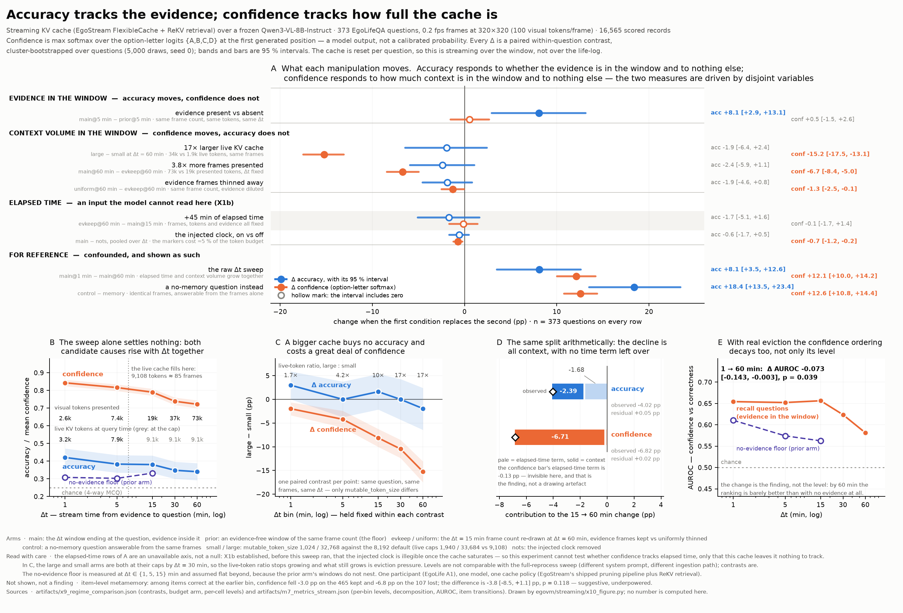
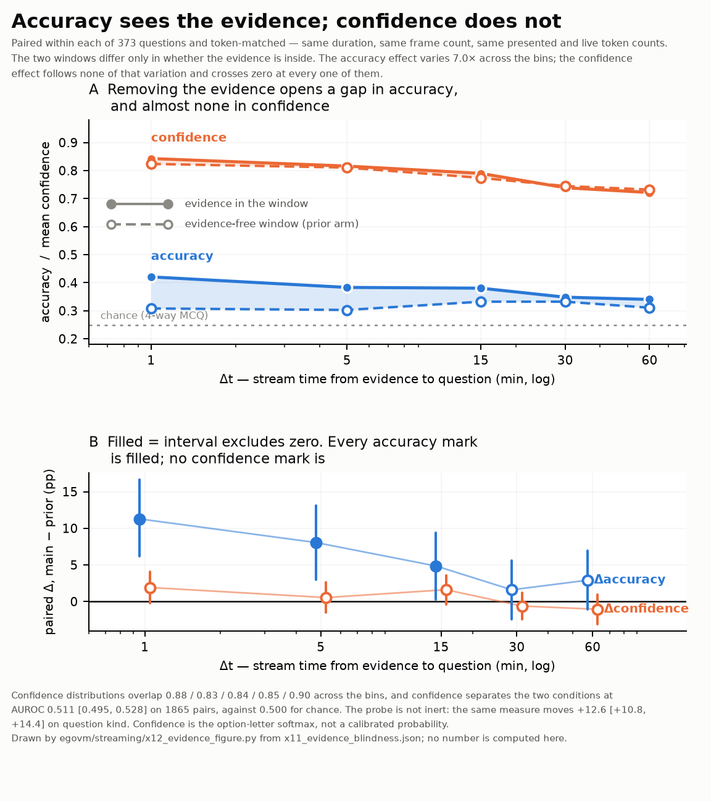

# Confidence tracks context, not evidence

**A video-LLM's confidence follows surface properties of its context — how long ago the stream
says something happened, how much visual input it has processed — rather than whether the
information needed to answer is actually present.** Accuracy responds to the evidence; confidence
does not, in either of two memory regimes.

This repository is a **concluded teaser study** (Aug 2026), run as groundwork before a larger
project on memory and self-knowledge in streaming egocentric video-LLMs. It set out to confirm a
hypothesis, rejected it, and documents what replaced it. The code, generated artifacts, figures
and audits here are the complete record of that study.

- **Model:** Qwen3-VL-8B-Instruct, frozen; no fine-tuning, no generation
- **Data:** EgoLifeQA, participant A1, 373 multiple-choice memory questions
- **Confidence:** max softmax over the option-letter logits `{A,B,C,D}` at the first generated
  position (the standard probe of Tsvilodub et al. 2024). This is a model output, never a
  calibrated probability.
- **Scale:** 5,540 + 17,311 scored records, ~20 GPU-h on single H100/A100s

---

## The question, and why the answer was "no"

> **Hypothesis.** *Streaming egocentric video-LLMs exhibit a widening gap between confidence and
> accuracy as evidence ages ("they don't know they forgot"), and a Δt/evidence-conditioned
> recalibration recovers most of the reliability at near-zero cost.*

The widening gap is **not there**. It was tested twice, in two memory regimes, and is absent from
both: in E1 the overconfidence gap moves −3.2 pp [−7.5, +1.0] over Δt = 1 → 60 min (p = 0.14).
What the controls show instead is a *dissociation* between what moves accuracy and what moves
confidence.

The design is what makes that dissociation identifiable. The naive sweep confounds elapsed time
with context length (the window grows with Δt), so the experiments add:
- **token-matched arms** that hold the visual-token count and evidence sampling fixed while elapsed
  time grows;
- a **`prior` arm** — a window of the same length and token count placed *before* the evidence, so
  the answer is simply not in context (the no-evidence floor);
- a **no-memory control question** at every checkpoint, answerable from the frames alone.

Every number below is a **paired within-question contrast** in percentage points,
cluster-bootstrapped over questions (5,000 draws, seed 0), with 95 % intervals.

## The two experiments

Both use the same 373 questions, the same 0.2 fps frame bank at a pinned 320 × 320 resolution,
and the same frozen backbone. They differ only in how the context reaches the model.

| | **E1 — full reprocess** | **E2 — streaming KV cache** |
| --- | --- | --- |
| regime | every checkpoint re-encodes its whole window | one ingestion into a bounded cache (EgoStream FlexibleCache + ReKV retrieval), queried at checkpoints |
| records | 5,540 | 17,311 |
| cost | ~6 GPU-h | ~14 GPU-h |
| modules | M0–M9 ([`egovm/`](Teaser-Experiment/egovm/)) | X0–X12 ([`egovm/streaming/`](Teaser-Experiment/egovm/streaming/)) |
| authoritative write-up | [`m8_teaser.md`](Teaser-Experiment/artifacts/m8_teaser.md) | [`x9_streaming.md`](Teaser-Experiment/artifacts/x9_streaming.md), [`x11_evidence_blindness.md`](Teaser-Experiment/artifacts/x11_evidence_blindness.md) |
| verdict (selected from the measured intervals) | *confidence tracks the wrong variable* | *the dissociation replicates* |

### E1 — confidence slides with elapsed time, which costs nothing



| manipulation (all else held fixed) | Δ accuracy | Δ confidence |
| --- | --- | --- |
| +45 min elapsed (tokens, evidence fixed) | +0.3 [−2.9, +3.2] | **−3.7 [−4.9, −2.4]** |
| 4× fewer visual tokens (Δt, evidence fixed) | **+2.4 [+0.3, +4.7]** | +0.3 [−0.5, +1.1] |
| evidence in context vs none (Δt = 5 min) | **+9.7 [+4.8, +14.5]** | +3.3 [+1.2, +5.4] |

Confidence responds to elapsed time, which is the one manipulation that costs no accuracy.
Accuracy responds to context length and to evidence, and confidence under-reacts to evidence by
2.9×. The decline is a flat discount that ignores which items are affected: items the model goes
on to lose show the same confidence drop as items it keeps (p = 0.62). The confidence *ranking*
stays intact across the sweep (AUROC 0.643 → 0.655).

### E2 — the same dissociation, rotated onto a different driver



| manipulation (all else held fixed) | Δ accuracy | Δ confidence |
| --- | --- | --- |
| evidence in context vs none (Δt = 5 min) | **+8.1 [+2.9, +13.1]** | +0.5 [−1.5, +2.6] |
| 17× larger live cache (Δt = 60 min) | −1.9 [−6.4, +2.4] | **−15.2 [−17.5, −13.1]** |
| 3.8× more frames presented, same live cache | −2.4 [−5.9, +1.1] | **−6.7 [−8.4, −5.0]** |
| +45 min elapsed (frames, tokens, evidence fixed) | −1.7 [−5.1, +1.6] | −0.1 [−1.7, +1.4] |

Accuracy responds to whether the evidence is in the window and to nothing else. Confidence
responds to how much visual input was processed, whether retained or not. Its dose–response is
monotone, while accuracy stays flat in every bin.

Elapsed time drops out. This is an **unavailable axis, not a null**: before the contrast was
computed, a probe (X1b) established that the injected clock is illegible once the cache
saturates. And with real eviction the confidence *ranking* decays too (AUROC −0.073, p = 0.039),
where in E1 it was flat.

### Evidence-blindness holds at every Δt



In E2 the evidence contrast is measured at all five Δt. Its accuracy effect runs from +11.3 pp at
1 min down into noise by 30–60 min, because the evidence advantage is itself evicted. Δconfidence
spans zero in all five bins and follows neither the effect nor its decay.

### Reading the two together

- **What holds across both:** confidence is evidence-blind in both regimes, and *more* so under
  streaming (the cross-regime Δconfidence difference is −2.8 pp [−5.1, −0.4]).
- **What changes:** the surface cue confidence latches onto.
  - E1's elapsed-time effect is absent in E2 (difference +3.5 pp [+1.7, +5.4]).
  - E2's context-volume effect is absent in E1 (difference −6.1 pp [−8.1, −4.1]).
- **E2 is not just a harder task.** On the one manipulation both regimes share, the accuracy cost
  is the same and the confidence response is not.

**What this means for the recalibration half of the hypothesis:**
- **Δt is the wrong conditioner.** It worked in E1 by accident and has no purchase in E2.
- **Live context size is a better one**, being observable and free.
- **"Evidence-conditioned" cannot be implemented at all**, because whether the evidence is in
  context is exactly what the model cannot report.
- **Recalibrating a level only helps while the ranking survives.** It survives under full
  reprocessing and does not under real eviction.

## What not to claim

[`Teaser-Experiment/INTERPRETATION.md`](Teaser-Experiment/INTERPRETATION.md) is the reading guide
for both experiments, and its §2.7 claims ladder is canonical. In short:

- **Safe:**
  - evidence moves accuracy and not confidence, in both regimes;
  - the predicted widening gap is absent in both;
  - under a bounded cache, confidence falls with the token budget while accuracy does not.
- **Defensible with a caveat:**
  - the "surface properties" synthesis (an account across two regimes, not one measured
    quantity);
  - the AUROC decay (one test, wants replication);
  - the sensitivity of E2's evidence contrast to the probe's denominator
    ([`CONFIDENCE-PROBE.md`](Report/Week1-Briefing/memo/CONFIDENCE-PROBE.md)).
- **Not supported:**
  - "streaming models don't know they forgot";
  - "confidence tracks the items actually lost";
  - "elapsed time does not affect confidence in streaming systems" (the axis was unavailable,
    which is not a null).

**Scope:** one participant, one 8B model, one cache policy, multiple-choice questions only.
Accuracy levels sit in a narrow band above the no-evidence floor (E1 bin-1 accuracy is 42.9 %
against a 31.4 % floor), so quote the contrasts, not the levels.

**Positioning:** EgoSAT (arXiv 2606.24422) also measures confidence under streaming and converges
on part of this; the overlap analysis is in
[`RELATED-EGOSAT.md`](Report/Week1-Briefing/memo/RELATED-EGOSAT.md). What this study adds is the
separation of elapsed time from context volume, and the evidence-present/absent contrast at
matched tokens.

## Open questions left for follow-up

The full ranked list is in [INTERPRETATION.md §2.8](Teaser-Experiment/INTERPRETATION.md). The
main items:

- **Strip the printed timestamps from E1** and re-score the token-matched cells (~1 GPU-h). This
  separates "confidence responds to elapsed time" from "confidence responds to printed numbers".
- **Recalibrate on live context size** per regime. This is CPU-only, from the existing records.
- **Restore a readable clock under streaming**, the one missing cell of the design.
- **Add explicit abstention** and an option-permutation bias check.

---

## Repository layout

| path | contents |
| --- | --- |
| [`Teaser-Experiment/`](Teaser-Experiment/) | Both experiments: the `egovm` package (E1 modules M0–M9, and E2 modules X0–X12 under `egovm/streaming/`), Slurm and helper scripts, committed artifacts and figures, and the design documents. |
| ↳ [`INTERPRETATION.md`](Teaser-Experiment/INTERPRETATION.md) | How to read both experiments, and what not to claim. **Start here before quoting any number.** |
| ↳ [`PLAN.md`](Teaser-Experiment/PLAN.md) / [`EXTENDING.md`](Teaser-Experiment/EXTENDING.md) | Design and findings of E1 (full reprocess) and E2 (streaming cache). |
| ↳ [`artifacts/`](Teaser-Experiment/artifacts/) | Every stage output that is small enough and safe to commit: plans, schedules, metrics JSON, generated write-ups. |
| [`Report/Week1-Briefing/`](Report/Week1-Briefing/) | A research briefing deck built so that no slide can quote a stale number (`make verify`), plus three audit memos covering the confidence probe, the streaming cache and the EgoSAT overlap. The memos are primary analysis. |
| [`Report/E2-Briefing/`](Report/E2-Briefing/) | A short deck of the E2 headline findings, reusing the verified macros and figures above. |

**When sources disagree, the artifact wins.** The generated write-ups (`m8_teaser.md`,
`x9_streaming.md`, `x11_evidence_blindness.md`) are produced from the metrics JSON, so they
cannot drift. All prose, including this README, is interpretation and may round.

The pipeline is split along verifiable-artifact boundaries. Each stage writes a file that can be
checked on its own, and downstream stages read only that file. There is no separate test suite.
Verification is done by inline assertions in the stage modules, plus the deck's nine-check
`make verify`.

## Reproducing

**Without a GPU or the dataset**, everything committed can be checked as-is:

```bash
cd Report/Week1-Briefing && make && make verify   # re-derives 191 macros from the metrics JSON; nine checks
```

**With the data**, see [`Teaser-Experiment/README.md`](Teaser-Experiment/README.md) for the
environment, download and run instructions. It also lists the cluster and streaming-cache
pitfalls that fail silently.

Data lives outside the repository at `$EGOVM_DATA` (~114 GB: video, frame bank, model snapshot,
raw records). The raw per-record files are pinned by checksum in
[`m6_records_manifest.json`](Teaser-Experiment/artifacts/m6_records_manifest.json):

```bash
python Teaser-Experiment/scripts/records_manifest.py --check   # 37 files, 22,873 ids
```

Re-analysis from the raw records is CPU-only. The full sweeps take ~6 GPU-h (E1) and ~14 GPU-h
(E2). E2 also needs an EgoStream checkout at `./EgoStream/` (or `$EGOVM_EGOSTREAM`). EgoStream
ships without a license, so it is not included; X0 records checksums of the upstream files it
depends on.

## Data and licensing

- **EgoLife / EgoLifeQA** are under the S-Lab License 1.0 (research use, not redistributable).
  **No video, frames, question text, answer-option text or caption text is committed.**
  - Artifacts reference questions by id only. Some (`m1_questions`, `m4_eval_plan`,
    `x2_stream_schedule`) also carry the gold option letter for each id.
  - The raw per-record files are not included.
  - The no-memory control questions are built from EgoLife DenseCaption text, so their file
    (`m5_control_questions.jsonl`) is not part of the public release. `python -m egovm.m5_controls` regenerates
    it from the downloaded captions.
- **Qwen3-VL-8B-Instruct** is Apache 2.0.
- **EgoStream** is used unmodified from an external checkout and is not redistributed.
- **This repository's own code, documents and figures** are released under the
  [MIT License](LICENSE). That license does not extend to any of the third-party data or code
  above.

## Acknowledgements

- EgoLife (Yang et al., 2025) for the dataset.
- Qwen3-VL for the backbone.
- EgoStream for the streaming cache, and ReKV (Di et al., 2025) for its retrieval design.
- EgoSAT (Lei et al., 2026) and Tsvilodub et al. (2024) for the option-letter confidence probe.
