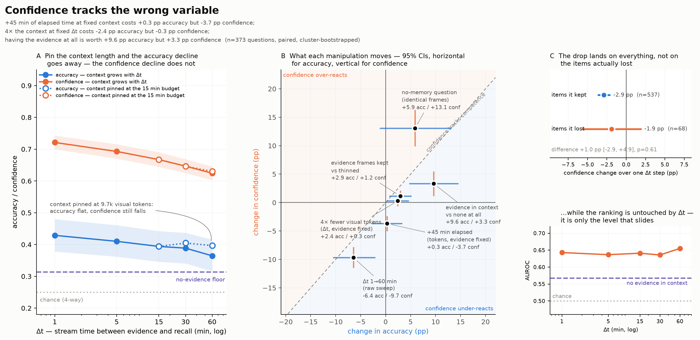
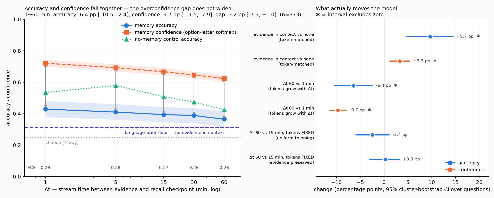

# Teaser result — does a streaming ego video-LLM know it forgot?

**Verdict: D: confidence tracks the wrong variable.** Elapsed time and context length move *different* measures. Holding visual-token count and evidence sampling fixed, an extra stretch of elapsed time costs +0.3 [-2.7, +3.2] pp of accuracy — nothing — while costing -3.7 [-5.0, -2.5] pp of confidence. Holding elapsed time fixed instead, cutting the context to a quarter is worth +2.4 [+0.3, +4.6] pp of accuracy but only +0.3 [-0.5, +1.1] pp of confidence. Confidence responds to the variable that costs the model nothing and ignores the one that costs it accuracy. And the largest accuracy effect in the whole experiment — having the evidence in context at all, +9.6 [+4.8, +14.5] pp — moves confidence only +3.3 [+1.2, +5.4] pp, a 2.9x under-reaction.

**The originally predicted signature is absent.** The overconfidence gap does not widen with Δt
(-3.2 [-7.5, +1.0] pp, p=0.1376) —
accuracy and confidence both fall over the raw sweep, and confidence falls slightly faster. What
replaced it is a sharper claim, because it is about *which* manipulations each measure responds
to rather than about the slope of one of them.

## What moves accuracy, and what moves confidence

Every row is paired within-question and cluster-bootstrapped over questions. The first three rows
are the argument; the rest are the context they sit in.

| manipulation | Δ accuracy | Δ confidence | n |
| --- | --- | --- | --- |
| +15 min elapsed (tokens, evidence fixed) | +1.1 [-1.9, +4.0] pp | -2.1 [-3.1, -1.1] pp | 373 |
| +45 min elapsed (tokens, evidence fixed) | +0.3 [-2.7, +3.2] pp | -3.7 [-5.0, -2.5] pp | 373 |
| 4× fewer visual tokens (Δt, evidence fixed) | +2.4 [+0.3, +4.6] pp | +0.3 [-0.5, +1.1] pp | 373 |
| evidence in context vs none (Δt=5 min) | +9.6 [+4.8, +14.5] pp | +3.3 [+1.2, +5.4] pp | 373 |
| evidence frames kept vs thinned (tokens, Δt fixed) | +2.9 [+0.8, +5.1] pp | +1.2 [+0.3, +2.0] pp | 373 |
| Δt 1→60 min (context grows with Δt) | -6.4 [-10.5, -2.1] pp | -9.7 [-11.4, -7.9] pp | 373 |
| Δt 1→60 min, no-memory question | -10.3 [-17.2, -3.2] pp | -10.7 [-13.4, -7.9] pp | 348 |
| no-memory vs recall question, identical frames (Δt=1 min) | +10.4 [+3.6, +17.2] pp | +13.9 [+10.9, +17.0] pp | 366 |
| no-memory vs recall question, identical frames (Δt=60 min) | +5.9 [-1.1, +13.0] pp | +13.1 [+10.0, +16.2] pp | 355 |

Read down the table: the two token-matched arms make elapsed time and context length separately
identifiable, and they come apart. Elapsed time is what confidence responds to, and it is the one
manipulation that costs no accuracy. Context length and evidence availability are what accuracy
responds to, and confidence barely registers either.

## The Δt sweep, decomposed

The `main` arm confounds elapsed time with context length — the window grows with Δt. The
token-matched arms break that, so the observed Δt=15→60 min
change splits into an elapsed-time part (`tokmatch_evkeep` at Δt=60 min against
`main` at Δt=15 min: same tokens, same evidence sampling) and a context-length
part (`main` against `tokmatch_evkeep`, both at Δt=60 min: same elapsed time):

| measure | elapsed time | context length | sum | observed | residual |
| --- | --- | --- | --- | --- | --- |
| accuracy | +0.3 pp | -2.4 pp | -2.1 pp | -2.9 pp | -0.8 pp |
| confidence | -3.7 pp | -0.3 pp | -4.0 pp | -4.3 pp | -0.3 pp |

Accuracy's decline is entirely the context-length term; confidence's decline is almost entirely
the elapsed-time term.

The raw sweep is therefore a composite of two effects that point in different directions for
confidence and accuracy, which is why reading it as "forgetting" is wrong.

## Is the confidence decline about the items that were lost?

No. Pooling over adjacent Δt steps and keeping only items the model had **right** at the
earlier bin, the confidence change is statistically identical whether it went on to lose the item
or keep it:

| items | n | confidence change |
| --- | --- | --- |
| kept (still correct) | 537 | -2.9 [-3.6, -2.1] pp |
| lost (now wrong) | 68 | -1.9 [-5.6, +1.9] pp |
| **difference** | | **+1.0 [-2.9, +4.9] pp**, p=0.612 |

The decline is a flat discount applied to every item, not a signal about the ones actually lost.
This is the item-level counterpart of the aggregate result: whatever drives confidence down is
reading the shape of the context, not the state of the memory.

**But the ranking is intact.** AUROC of confidence against correctness is
0.643 at Δt=1 min and 0.655 at
Δt=60 min (+0.012 [-0.046, +0.071] over the sweep), so the model's *ordering* of
which answers it will get right is untouched by Δt — it is the level that slides.
With no evidence in context the ordering does degrade, to AUROC 0.568, so the signal is real and evidence-dependent; it simply never surfaces in the confidence level.
That matters for what to do about this: the usable signal is there to be recalibrated, not
missing.

## Setup

Qwen/Qwen3-VL-8B-Instruct (Apache 2.0), BF16 on one NVIDIA H100 NVL MIG 3g.47gb. EgoLifeQA participant
A1/Jake — the only released participant — restricted by Mitigation 1 to the time-invariant
categories EntityLog + EventRecall + RelationMap. Evidence timestamps come from the released
`target_time` field, which is populated on all 500 items.

Δt is elapsed **stream** time (video the model has actually observed) between the evidence
and the recall checkpoint, not wall-clock: the A1 recording has 31 gaps including six
overnight breaks. Frames are sampled at 0.2 fps at a pinned 320x320
(50.0 visual tokens/frame, verified constant in window length).
Confidence is the softmax over the option-letter logprobs {A,B,C,D}; no text is generated.
It is a proxy, reported with ECE, not a calibrated probability.

## The Δt sweep itself

| Δt (min) | n | accuracy % | confidence % | gap (pp) | ECE | frames | visual tokens |
| --- | --- | --- | --- | --- | --- | --- | --- |
| 1 | 373 | 42.9 | 72.1 | +29.2 | 0.292 | 26 | 1279 |
| 5 | 373 | 41.0 | 69.3 | +28.3 | 0.283 | 74 | 3679 |
| 15 | 373 | 39.4 | 66.7 | +27.3 | 0.274 | 194 | 9679 |
| 30 | 373 | 38.9 | 64.7 | +25.8 | 0.258 | 374 | 18679 |
| 60 | 373 | 36.5 | 62.4 | +26.0 | 0.260 | 734 | 36679 |

Paired over the 373 questions present at both ends
(1 -> 60 min), cluster-bootstrapped over questions:

| quantity | change | p |
| --- | --- | --- |
| accuracy | -6.4 [-10.5, -2.4] pp | 0.0024 |
| confidence | -9.7 [-11.5, -7.9] pp | 0.0000 |
| **overconfidence gap** | **-3.2 [-7.5, +1.0] pp** | 0.1376 |

The gap row is the bin x {accuracy, confidence} interaction the design was originally powered
for. It is the null this write-up leads away from — the sweep alone cannot say what caused
either decline, which is what the decomposition above is for.

## Evidence awareness

Token-matched at 3679 visual tokens, paired over
373 questions, the *only* difference being whether the window contains the evidence:

| | no evidence in context | evidence in context | change |
| --- | --- | --- | --- |
| accuracy | 31.4% | 41.0% | **+9.7 [+4.8, +14.5] pp** |
| confidence | 66.0% | 69.3% | **+3.3 [+1.2, +5.4] pp** |

Having the evidence is worth 9.7 points of accuracy but only
3.3 points of confidence — the confidence signal is about
2.9x weaker than the
competence it is supposed to track. The model is nearly as confident answering from nothing as
from the evidence.

## Controls

**Language-prior floor** — the same questions over an evidence-free window: 31.4% accuracy at 66.0% confidence (n=373).
Any accuracy above this floor is what the video evidence is buying, so the sweep is only
informative between that floor and the Δt=1 min bin — a narrow band here.

**No-memory control** — a current-instant question over the identical context:

| Δt (min) | n | accuracy % | confidence % |
| --- | --- | --- | --- |
| 1 | 366 | 53.6 | 86.0 |
| 5 | 366 | 57.9 | 85.4 |
| 15 | 362 | 50.8 | 81.0 |
| 30 | 361 | 47.4 | 78.1 |
| 60 | 355 | 42.5 | 75.2 |

This was meant to stay flat and rule generic long-context degradation *out*. It does not — it
falls further than the memory questions do, which is the clearest sign that the sweep is
measuring the context window rather than memory. Two caveats: each checkpoint gets its own
control item, so this is a between-items comparison, and the control has so far only been run on
`main` frames, so its decline has not itself been token-matched (supplement S2).

**Token-matched** — Δt=60 min subsampled to the Δt=15 min visual-token count:

| arm | n | tokens (ref) | acc @15 min % | acc @60 min % | Δ accuracy |
| --- | --- | --- | --- | --- | --- |
| `tokmatch_uniform` | 373 | 9679 | 39.4 | 37.0 | -2.4 [-5.9, +1.1] pp |
| `tokmatch_evkeep` | 373 | 9679 | 39.4 | 39.7 | +0.3 [-2.9, +3.2] pp |

`tokmatch_uniform` thins the whole window; `tokmatch_evkeep` keeps every frame near the
evidence and thins only the filler, so it holds token count *and* evidence resolution fixed
and leaves elapsed time as the only difference. Comparing the two isolates evidence resolution;
comparing either against `main` at the same Δt isolates context length. Those three comparisons
are the manipulation table above — this block is the raw material for them.

## By category

| category | acc @1 min % | acc @60 min % | conf @1 min % | conf @60 min % |
| --- | --- | --- | --- | --- |
| EntityLog | 37.6 | 33.6 | 74.4 | 66.5 |
| EventRecall | 52.4 | 43.5 | 81.8 | 73.0 |
| RelationMap | 38.7 | 32.3 | 60.1 | 47.7 |

## Robustness: dropping the audio-dependent questions

1639 records come from questions flagged `need_audio`, which a
vision-only model cannot answer in principle. Re-running the whole analysis without them
(n=263 paired questions) changes nothing that matters:

| quantity | all questions | vision-only |
| --- | --- | --- |
| accuracy, 1→60 min | -6.4 [-10.5, -2.4] pp | -6.4 [-11.4, -1.5] pp |
| confidence, 1→60 min | -9.7 [-11.5, -7.9] pp | -9.4 [-11.5, -7.2] pp |
| overconfidence gap | -3.2 [-7.5, +1.0] pp | -3.0 [-8.1, +2.3] pp |
| evidence vs none, accuracy | +9.7 [+4.8, +14.5] pp | +11.4 [+5.3, +17.5] pp |
| evidence vs none, confidence | +3.3 [+1.2, +5.4] pp | +4.0 [+1.6, +6.5] pp |
| `tokmatch_evkeep` accuracy | +0.3 [-2.9, +3.2] pp | +0.8 [-3.0, +4.6] pp |

## Caveats
- The model sees a *window* around the evidence, not the full 44 h history EgoLifeQA assumes,
  so absolute accuracy is not comparable to published EgoLifeQA numbers. The claim is about
  the slope and the gap, not the level.
- One participant, one model. N per bin is bounded by the single released EgoLife participant.
- Control questions are auto-generated from the DenseCaption track and posed in Chinese
  (the captions are Chinese); they are compared only against themselves across Δt.
